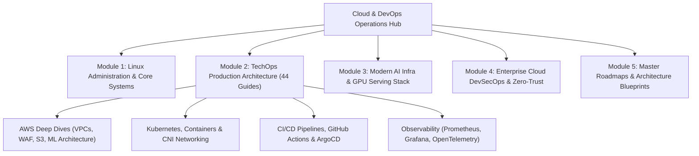

# 🚀 Cloud Operations & Production Platform Engineering Master Suite

A comprehensive, production-grade compendium of Cloud, DevOps, DevSecOps, SRE, and Modern AI Platform Engineering knowledge, architecture blueprints, hands-on labs, and real-world implementation guides.

---

## 📑 Curriculum & Repository Architecture

---

## 📚 Module Overview

| Module | Category | Description | Direct Access |
|:---|:---|:---|:---|
| **Module 01** | Linux Administration | Core Linux engineering, terminal operations, users/groups, process inspection, and bash automation. | [Explore Module 01](modules/01-linux/) |
| **Module 02** | TechOps Production Guides | 44 hands-on deep dives covering AWS networking, security automation, machine learning infra, containers, and IaC. | [Explore Module 02](modules/02-techops-production-guides/) |
| **Module 03** | Modern AI Infra Stack | Curated architecture guide on the top 10 open-source platforms for AI/ML workloads (vLLM, Triton, KEDA, Kubeflow, ArgoCD). | [Explore Module 03](modules/03-modern-ai-infra-stack/) |
| **Module 04** | Cloud DevSecOps & Security | Zero-Trust architecture, container vulnerability scanning, secrets lifecycle, and compliance frameworks. | [Explore Module 04](modules/04-cloud-devsecops-security/) |
| **Module 05** | Master Roadmaps & Blueprints | Multi-Cloud DevOps & AI Master Roadmap and full-scale enterprise blueprints. | [Explore Module 05](modules/05-master-roadmaps-and-blueprints/) |

---

## 🛠️ Module 02: Hands-On TechOps Production Guides Index

Below is the complete index of all 44 engineering guides:

| # | Guide Title | Topic / Domain | Direct Link |
|:---:|:---|:---|:---|
| 01 | `01-aws-networking-subnets-basics.md` | **Networking & VPC** | [Read Guide](modules/02-techops-production-guides/01-aws-networking-subnets-basics.md) |
| 02 | `02-automatically-block-suspicious-traffic.md` | **Cloud Security & IAM** | [Read Guide](modules/02-techops-production-guides/02-automatically-block-suspicious-traffic.md) |
| 03 | `03-how-aws-signed-urls-work-internally.md` | **Cloud Security & IAM** | [Read Guide](modules/02-techops-production-guides/03-how-aws-signed-urls-work-internally.md) |
| 04 | `04-designing-aws-machine-learning-architecture.md` | **AI & ML Architecture** | [Read Guide](modules/02-techops-production-guides/04-designing-aws-machine-learning-architecture.md) |
| 05 | `05-how-aws-secures-inbound-and-outbound-traffic.md` | **AWS & Cloud** | [Read Guide](modules/02-techops-production-guides/05-how-aws-secures-inbound-and-outbound-traffic.md) |
| 06 | `06-secure-three-tier-architecture-aws.md` | **AWS & Cloud** | [Read Guide](modules/02-techops-production-guides/06-secure-three-tier-architecture-aws.md) |
| 07 | `07-aws-internet-gateway-vs-nat-gateway.md` | **AWS & Cloud** | [Read Guide](modules/02-techops-production-guides/07-aws-internet-gateway-vs-nat-gateway.md) |
| 08 | `08-scalable-file-upload-architecture.md` | **AWS & Cloud** | [Read Guide](modules/02-techops-production-guides/08-scalable-file-upload-architecture.md) |
| 09 | `09-aws-lambda-concurrency-and-throttling-prevention.md` | **AWS & Cloud** | [Read Guide](modules/02-techops-production-guides/09-aws-lambda-concurrency-and-throttling-prevention.md) |
| 10 | `10-amazon-s3-cross-origin-resource-sharing-cors.md` | **AWS & Cloud** | [Read Guide](modules/02-techops-production-guides/10-amazon-s3-cross-origin-resource-sharing-cors.md) |
| 11 | `11-architecture-to-overcome-api-gateway-payload-limit.md` | **AWS & Cloud** | [Read Guide](modules/02-techops-production-guides/11-architecture-to-overcome-api-gateway-payload-limit.md) |
| 12 | `12-kubernetes-pod-disruption-budget-pdb-guide.md` | **Containers & Kubernetes** | [Read Guide](modules/02-techops-production-guides/12-kubernetes-pod-disruption-budget-pdb-guide.md) |
| 13 | `13-provisioned-concurrency-aws-lambda-cold-starts.md` | **AWS & Cloud** | [Read Guide](modules/02-techops-production-guides/13-provisioned-concurrency-aws-lambda-cold-starts.md) |
| 14 | `14-how-to-reduce-docker-image-size.md` | **Containers & Kubernetes** | [Read Guide](modules/02-techops-production-guides/14-how-to-reduce-docker-image-size.md) |
| 15 | `15-multi-cloud-gitops-workflow-kubernetes.md` | **Containers & Kubernetes** | [Read Guide](modules/02-techops-production-guides/15-multi-cloud-gitops-workflow-kubernetes.md) |
| 16 | `16-github-actions-workflow-terraform-workspaces.md` | **CI/CD & GitOps** | [Read Guide](modules/02-techops-production-guides/16-github-actions-workflow-terraform-workspaces.md) |
| 17 | `17-convert-existing-cloud-infrastructure-to-terraform.md` | **AWS & Cloud** | [Read Guide](modules/02-techops-production-guides/17-convert-existing-cloud-infrastructure-to-terraform.md) |
| 18 | `18-kubernetes-node-not-ready-troubleshooting.md` | **Containers & Kubernetes** | [Read Guide](modules/02-techops-production-guides/18-kubernetes-node-not-ready-troubleshooting.md) |
| 19 | `19-shopify-bigquery-1m-query-cost-analysis.md` | **AWS & Cloud** | [Read Guide](modules/02-techops-production-guides/19-shopify-bigquery-1m-query-cost-analysis.md) |
| 20 | `20-aws-prime-day-record-breaking-traffic.md` | **AWS & Cloud** | [Read Guide](modules/02-techops-production-guides/20-aws-prime-day-record-breaking-traffic.md) |
| 21 | `21-hidden-risks-kubernetes-security-labels.md` | **Cloud Security & IAM** | [Read Guide](modules/02-techops-production-guides/21-hidden-risks-kubernetes-security-labels.md) |
| 22 | `22-detecting-mitigating-vulnerabilities-docker-scout.md` | **Containers & Kubernetes** | [Read Guide](modules/02-techops-production-guides/22-detecting-mitigating-vulnerabilities-docker-scout.md) |
| 23 | `23-exposed-aws-keys-secrets-prevention.md` | **AWS & Cloud** | [Read Guide](modules/02-techops-production-guides/23-exposed-aws-keys-secrets-prevention.md) |
| 24 | `24-well-structured-terraform-project-guide.md` | **AWS & Cloud** | [Read Guide](modules/02-techops-production-guides/24-well-structured-terraform-project-guide.md) |
| 25 | `25-cloud-disaster-recovery-strategies-rto-rpo.md` | **AWS & Cloud** | [Read Guide](modules/02-techops-production-guides/25-cloud-disaster-recovery-strategies-rto-rpo.md) |
| 26 | `26-why-container-should-have-only-one-process.md` | **AI & ML Architecture** | [Read Guide](modules/02-techops-production-guides/26-why-container-should-have-only-one-process.md) |
| 27 | `27-aws-vpc-gateway-endpoints-cost-optimization.md` | **Networking & VPC** | [Read Guide](modules/02-techops-production-guides/27-aws-vpc-gateway-endpoints-cost-optimization.md) |
| 28 | `28-problem-with-overusing-terraform-dynamic-blocks.md` | **Cloud Security & IAM** | [Read Guide](modules/02-techops-production-guides/28-problem-with-overusing-terraform-dynamic-blocks.md) |
| 29 | `29-how-levelsfyi-cuts-cloud-bill-by-15-percent.md` | **AWS & Cloud** | [Read Guide](modules/02-techops-production-guides/29-how-levelsfyi-cuts-cloud-bill-by-15-percent.md) |
| 30 | `30-kubernetes-air-gap-cluster-implementation.md` | **AI & ML Architecture** | [Read Guide](modules/02-techops-production-guides/30-kubernetes-air-gap-cluster-implementation.md) |
| 31 | `31-aws-vpc-peering-deep-dive.md` | **Networking & VPC** | [Read Guide](modules/02-techops-production-guides/31-aws-vpc-peering-deep-dive.md) |
| 32 | `32-aws-hexagonal-architecture-pattern.md` | **AWS & Cloud** | [Read Guide](modules/02-techops-production-guides/32-aws-hexagonal-architecture-pattern.md) |
| 33 | `33-cloud-scaling-patterns-horizontal-vertical-queue.md` | **AWS & Cloud** | [Read Guide](modules/02-techops-production-guides/33-cloud-scaling-patterns-horizontal-vertical-queue.md) |
| 34 | `34-aws-vpc-network-segmentation-deep-dive.md` | **Networking & VPC** | [Read Guide](modules/02-techops-production-guides/34-aws-vpc-network-segmentation-deep-dive.md) |
| 35 | `35-cloudfront-signed-url-vs-s3-presigned-url.md` | **Cloud Security & IAM** | [Read Guide](modules/02-techops-production-guides/35-cloudfront-signed-url-vs-s3-presigned-url.md) |
| 36 | `36-mxplayer-scaling-eks-spot-instances.md` | **AWS & Cloud** | [Read Guide](modules/02-techops-production-guides/36-mxplayer-scaling-eks-spot-instances.md) |
| 37 | `37-aws-lambda-integration-patterns-sqs-sns.md` | **AWS & Cloud** | [Read Guide](modules/02-techops-production-guides/37-aws-lambda-integration-patterns-sqs-sns.md) |
| 38 | `38-secure-s3-buckets-for-public-data-storage.md` | **AWS & Cloud** | [Read Guide](modules/02-techops-production-guides/38-secure-s3-buckets-for-public-data-storage.md) |
| 39 | `README.md` | **AWS & Cloud** | [Read Guide](modules/02-techops-production-guides/README.md) |

---

## 🔗 Related Repositories in this Portfolio

* 💼 **[JD-Analyzation----Remote-JOB-Related-Data-Analyzation](https://github.com/Nova-Jaat/JD-Analyzation----Remote-JOB-Related-Data-Analyzation)**: 50+ In-Depth Remote Job Description Analyses & Market Strategy.
* 🛡️ **[Mindmap-shiv](https://github.com/Nova-Jaat/Mindmap-shiv)**: Cybersecurity & Cloud Security Mindmaps.
* ☁️ **[MultiCloud-DevOps-AI-Challenge](https://github.com/Nova-Jaat/MultiCloud-DevOps-AI-Challenge)**: Multi-Cloud DevOps & AI Hands-on Workshop Sessions.

---

### 👨‍💻 Maintained By
**Sanjeev Kumar ([@Nova-Jaat](https://github.com/Nova-Jaat))**  
*Cloud, DevOps & DevSecOps Platform Engineer*
