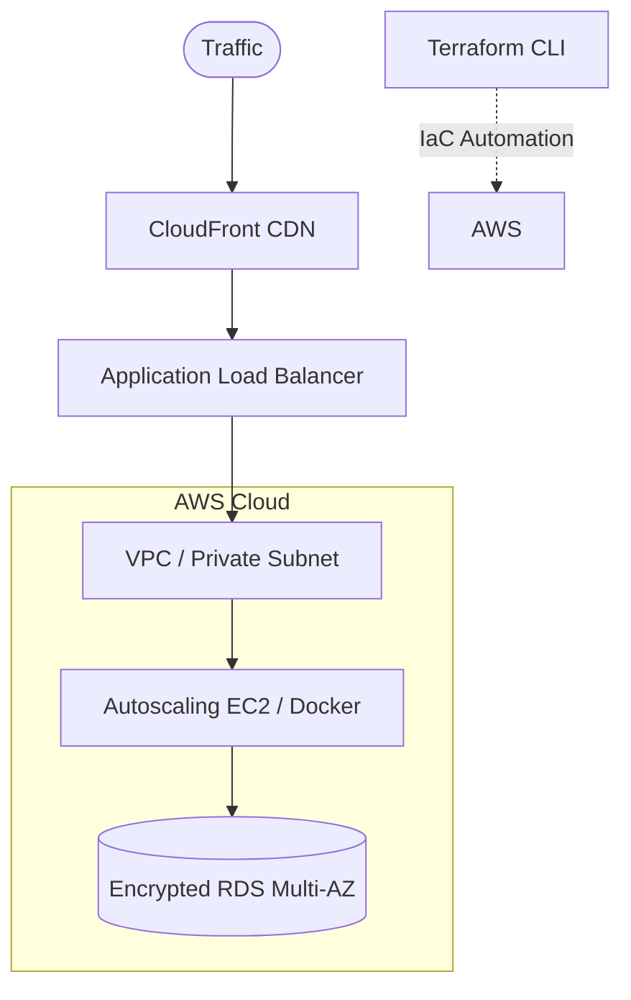

# AI-Powered Job Hunting Playbook (2026 Edition)
### A Modern, Tactical Guide to High-Conversion Tech & Engineering Job Search

---

## 1. Executive Overview: The Paradigm Shift in 2026

The traditional job search playbook is broken. Blasting out 500 identical resumes, scrolling job boards for hours, and relying on generic interview preparation yields diminishing returns. In 2026, recruiting is heavily filtered by AI on the employer side—which means candidates must use AI strategically to stand out.

> **Core Philosophy:**  
> The goal of AI in job hunting is **not** to invent an artificial version of you or flood companies with automated spam. The goal is to **surface your real, verifiable expertise faster, eliminate administrative friction, and present compelling proof of work.**

### The Old Way vs. The Modern AI-Powered Way

| Job Search Phase | The Old Way (Low Conversion) | The 2026 AI Way (High Conversion) | Tech/DevOps Advantage |
| :--- | :--- | :--- | :--- |
| **1. Discovery** | Manually scrolling Indeed/LinkedIn job feeds for hours. | **Targeted Boolean Scraping + Natural Language Filtering.** | Pinpoint direct ATS links (Greenhouse/Lever) with exact tech overlap. |
| **2. Resume Tailoring** | Generic Word resume or paid builder templates that fail ATS. | **Gap-Analysis Prompting + Clean Single-Column Markdown/DOCX.** | Aligns verified accomplishments to the JD using the Google X-Y-Z formula. |
| **3. Company Research** | Reading superficial Glassdoor reviews one by one. | **Deep Research (Claude/Perplexity) into tech stack & financials.** | Understand their architecture, engineering blogs, and business bottlenecks. |
| **4. Interview Prep** | Watching generic YouTube "Top 10 Questions" videos. | **Interactive Voice AI Mock Grill & Scenario Troubleshooting.** | Live simulation of incident triage, architecture design, and STAR answers. |
| **5. Proof of Work** | Claiming skills as a bulleted list of buzzwords. | **1-Page Architecture Case Studies & Public GitHub Repos.** | Tangible proof: Terraform modules, CI/CD pipelines, and architecture diagrams. |
| **6. Tracking** | Scattered bookmarks, forgotten emails, and missed follow-ups. | **Structured Notion / Markdown Pipeline with follow-up triggers.** | Zero dropped leads, clear record of which resume version was sent to whom. |

---

## 2. Phase 1: High-Precision Job Discovery & Sourcing

Stop searching general portals without filters. Use precision Boolean operators to target direct Applicant Tracking System (ATS) application links where listings are active and unmediated by agencies.

### 2.1 Direct ATS Google Dorks (Copy & Paste into Google)

Target job listings hosted directly on top ATS platforms to bypass agency spam, aggregator reposts, and saturated LinkedIn feeds:

#### The 10 Essential ATS Domains
| ATS Engine | Primary Search Pattern | Best For |
| :--- | :--- | :--- |
| **Ashby** | `site:jobs.ashbyhq.com` | Modern tech startups, YC scaleups, remote-first SaaS |
| **Greenhouse** | `site:boards.greenhouse.io` (or `site:greenhouse.io`) | Top tech unicorns, Series B-D scaleups, product firms |
| **Lever** | `site:jobs.lever.co` | High-growth tech and modern SaaS companies |
| **SmartRecruiters** | `site:jobs.smartrecruiters.com` | Mid-to-large global tech companies |
| **Workday** | `site:myworkdayjobs.com` (covers `wd1`, `wd3`, etc.) | Fortune 500 MNCs, Enterprise IT & Banking |
| **BambooHR** | `site:jobs.bamboohr.com` (or `site:bamboohr.com`) | Boutique consultancies, cloud agencies, mid-market IT |
| **Jobvite** | `site:jobs.jobvite.com` | Enterprise IT and telecom conglomerates |
| **iCIMS** | `site:careers.icims.com` (or `site:icims.com`) | Global system integrators and large enterprises |
| **JazzHR** | `site:apply.jazz.co` | Agile early-stage tech teams & boutiques |
| **Workable** | `site:careers.workable.com` | International SaaS & distributed teams |

#### Multi-Platform Mega-Dorks (Search Entire Tiers at Once)

```text
# 1. Startup & Modern Scaleup Mega-Dork (Ashby + Greenhouse + Lever)
(site:jobs.ashbyhq.com OR site:boards.greenhouse.io OR site:jobs.lever.co) ("DevOps" OR "Cloud Engineer" OR "Platform Engineer") ("India" OR "Remote")

# 2. Enterprise & MNC Mega-Dork (Workday + SmartRecruiters + iCIMS)
(site:myworkdayjobs.com OR site:jobs.smartrecruiters.com OR site:careers.icims.com) ("Cloud Engineer" OR "DevOps Engineer") "India"

# 3. Stack-Targeted Dork (Linux + Terraform + Multi-Cloud)
(site:jobs.ashbyhq.com OR site:boards.greenhouse.io OR site:jobs.lever.co) ("DevOps" OR "Cloud") ("Terraform" AND "Linux") ("India" OR "Remote")
```

> [!TIP]
> **Subdomain Fallback & Freshness:**
> - If `wd1.myworkdayjobs.com` returns few hits, broaden to `myworkdayjobs.com`.
> - Always append `&tbs=qdr:w` to your Google URL (or select **Tools > Past week**) to eliminate closed or stale openings.
> - For a 1-click interactive interface with live filters, launch `ats_search_launcher.html` directly in your browser.

### 2.2 ChatGPT / Claude Natural Language Discovery Prompt

When searching platforms with web-connected LLMs (ChatGPT with Search, Claude with Search, or Perplexity):

```markdown
Prompt:
"Act as an expert technical talent scout. Find 5 open, active job vacancies for an Associate to Mid-Level Cloud Infrastructure / DevOps Engineer matching these exact criteria:
- Primary Stack: Linux (RHEL/Ubuntu), AWS or Azure, Terraform (IaC), Docker, Bash.
- Geography: Remote within India, or hybrid in [Your Target City], or international remote with Asia/UK timezone overlap.
- Posting freshness: Published within the last 7 days.
- Source preference: Direct employer career boards (Greenhouse, Lever, Ashby, or Workday), NOT third-party scrapers.

For each opening, provide:
1. Company Name & Industry
2. Job Title
3. Direct application URL
4. Key mandatory requirements
5. Highlighted differentiator (e.g., funding, product scale, AI workloads)"
```

---

## 3. Phase 2: High-Conversion ATS Resume Tailoring

Paid tools like Kickresume, Novoresume, or Canva often use multi-column layouts, graphics, and text boxes that scramble older ATS parsers (like Taleo or Workday). Use a clean, single-column document and prompt your LLM to perform an honest gap analysis.

```
┌──────────────────────────────────────────────────────────────┐
│                    THE 3-STEP RESUME ENGINE                  │
├──────────────────────────────────────────────────────────────┤
│  1. GAP ANALYSIS   ──► Identify missing keywords & themes   │
│  2. X-Y-Z FORMULA  ──► Reframe bullets with concrete metrics │
│  3. VERIFICATION   ──► Strip any hallucinated experience     │
└──────────────────────────────────────────────────────────────┘
```

### 3.1 The ATS Tailoring Master Prompt

```markdown
Prompt:
"You are a Principal Technical Recruiter and ATS Optimization Expert specializing in Cloud Infrastructure, DevOps, and Systems Engineering.

I will provide you with two inputs:
1. MY MASTER RESUME (My authentic, verified background)
2. TARGET JOB DESCRIPTION (The role I am targeting)

Your task is to tailor my resume for maximum ATS alignment and hiring manager impact following these STRICT RULES:
1. TRUTHFULNESS: Never invent companies, years of experience, or skills I do not possess. Only highlight, rephrase, and emphasize real experience from my master resume.
2. GOOGLE X-Y-Z FORMULA: Format every achievement bullet as:
   'Accomplished [X], as measured by [Y], by doing [Z]'
3. KEYWORD INTEGRATION: Natural incorporation of the JD's exact technical terminology (e.g., 'Infrastructure as Code', 'Remote State Management', 'RBAC', 'Container Security').
4. ATS READABILITY: Single-column format, standard section headings (Summary, Technical Skills, Professional Experience, Certifications, Education).

Please provide the output in two sections:
Section A: GAP ANALYSIS (List 3 skills in the JD I match strongly, 2 potential gaps, and how we bridged them).
Section B: COMPLETE TAILORED RESUME IN MARKDOWN FORMAT.

---
[PASTE YOUR MASTER RESUME HERE]
---
[PASTE TARGET JOB DESCRIPTION HERE]"
```

### 3.2 Before vs. After Bullet Point Transformation

* **Bad / Generic Bullet:**  
  * *“Created Terraform scripts to launch servers in AWS and worked with team on automation.”*
* **ATS-Optimized X-Y-Z Bullet:**  
  * *“Automated multi-tier AWS infrastructure provisioning using modular Terraform and remote S3 state locks, reducing environment spin-up time from 45 minutes to under 45 seconds while enforcing zero-drift policy.”*

---

## 4. Phase 3: Deep Company & Architecture Research

Never walk into an interview with only basic surface knowledge from the company's "About Us" page. Find the business and architectural problem behind the vacancy.

```
                  ┌───────────────────────────────┐
                  │    WHY DOES THIS VACANCY      │
                  │         EXIST NOW?            │
                  └──────────────┬────────────────┘
         ┌───────────────────────┼───────────────────────┐
         ▼                       ▼                       ▼
┌──────────────────┐   ┌───────────────────┐   ┌───────────────────┐
│ Revenue & Scale  │   │ Tech Stack Shift  │   │ Reliability Pains │
│ New market expansion,│ Migration to AKS, │ Downtime incidents,   │
│ funding, acquisitions│ IaC modernization │ compliance/audit gaps │
└──────────────────┘   └───────────────────┘   └───────────────────┘
```

### 4.1 Claude / Perplexity Research Prompt

```markdown
Prompt:
"I am interviewing for a [Job Title] role at [Target Company]. Conduct deep technical and business research using current sources and provide a concise briefing covering:

1. Business Model & Scale:
   - What are their core revenue-generating products?
   - Who are their primary enterprise customers (B2B SaaS, FinTech, E-commerce)?
   - What recent funding rounds, mergers, or revenue milestones occurred in the past 12 months?

2. Engineering & Infrastructure Footprint:
   - What is their known technology stack (Cloud providers, databases, orchestrators)?
   - Search for public engineering blog posts, GitHub repos, or tech talks by their engineers.
   - Have they recently undergone migrations (e.g., monolith to microservices, on-prem to AWS/Azure, multi-region expansion)?

3. Operational Pain Points & Why This Role Exists:
   - What scaling, reliability, or security challenges is an infrastructure engineer likely hired to solve here right now?

4. Reverse Interview Arsenal:
   - Provide 3 thoughtful, technical questions I can ask the Lead Architect or Engineering Director that demonstrate I understand their production challenges."
```

---

## 5. Phase 4: High-Pressure Technical Interview Simulation

Generic video practice doesn't prepare you for deep architectural grill sessions. Turn your LLM into a tough hiring manager or technical interviewer.

### 5.1 The Technical Mock Interviewer Prompt

```markdown
Prompt:
"You are a strict, senior Technical Hiring Manager at an enterprise software company. You are conducting a 1-on-1 technical screening for a candidate applying for:
Role: Cloud Infrastructure & DevOps Engineer
Candidate's Core Stack: Linux (RHCSA certified), AWS, Azure, Terraform, Docker, Bash.

INTERVIEW PROTOCOL:
1. Conduct the interview ONE QUESTION AT A TIME. Wait for my response before proceeding.
2. Do not be overly polite or sycophantic. If my answer is vague, surface-level, or missing production edge cases, press me for specifics (e.g., 'What happens if the state file gets locked?', 'How do you troubleshoot high iowait?').
3. Ask a balanced mix of:
   - Low-level Linux troubleshooting (kernel signals, systemd, networking, disk IO).
   - Infrastructure as Code (Terraform state, modules, drift detection).
   - Real-world incident response scenarios.
4. After 5 questions, give me a comprehensive score report (Strengths, Red Flags, Recommended Refinements).

Begin now by introducing yourself briefly and asking your first technical question."
```

### 5.2 The STAR-L Framework for Behavioral & Incident Questions

When answering behavioral questions, use **STAR-L**:

| Component | Focus | Example (Cloud / Incident Response) |
| :--- | :--- | :--- |
| **S - Situation** | Context, scale, and immediate constraint. | *"During peak hours, an automated deployment triggered high CPU alerts across 8 nodes."* |
| **T - Task** | Your personal ownership. | *"As the on-call engineer, my task was to stabilize traffic and identify the root cause without data loss."* |
| **A - Action** | Specific technical decisions taken. | *"I inspected `dmesg` and `top`, discovered memory exhaustion killing worker processes, rolled back the release via GitOps, and adjusted container resource limits."* |
| **R - Result** | Quantifiable business metric. | *"Restored full SLA within 4 minutes with zero lost requests."* |
| **L - Learning** | Prevention and architectural hardening. | *"Implemented strict Kubernetes horizontal pod autoscaling (HPA) and alert thresholds in Prometheus."* |

---

## 6. Phase 5: Proof of Work — The 1-Page Architecture Case Study

While non-technical roles use slide decks (like Gamma), engineering managers want to see **how you think and build**. A concise 1-page architecture document or public GitHub repository has 10x more credibility than buzzwords on a CV.

### 6.1 The 1-Page Case Study Template (Markdown)

```markdown
# Case Study: Zero-Downtime Infrastructure Automation with Terraform & AWS
**Author:** Sanjeev Kumar (Cloud Infrastructure Engineer)  
**Repository:** [github.com/your-username/aws-terraform-modular-vpc](https://github.com)

## 1. Problem Statement
Manual provisioning of staging and production environments was taking 45+ minutes per deployment, resulting in configuration drift, inconsistent security group rules, and accidental port exposure.

## 2. Architecture & Design Decisions


## 3. Implementation Details
- **Modularity:** Built reusable Terraform modules for VPC, Subnets, IAM Roles, and Security Groups.
- **State Management:** Remote S3 backend configured with DynamoDB state locking to prevent concurrency collisions.
- **Security Hardening:** Enforced zero public access on database subnets and parameterized IAM least-privilege policies.

## 4. Quantitative Results & Impact
- Provisioning time reduced from **45 minutes to < 45 seconds** (98% reduction).
- Environment consistency reached 100%, completely eliminating configuration drift.
- Security audit passed with zero exposed administrative ports.

## 5. Lessons Learned
Handling state locks during interrupted CI/CD pipeline runs required automating unlock safeguards with strict verification hooks.
```

---

## 7. Phase 6: Systematic Opportunity Tracking & Pipeline

Job searching is a sales pipeline. If you don't track metrics, you can't optimize your conversion rate.

### 7.1 Markdown Pipeline Tracker (Store in your workspace)

Save this table directly in your workspace notes as `JOB_APPLICATIONS_TRACKER.md`:

| Company | Target Role | Salary / CTC | Date Applied | Resume Version | Lead / Contact | Current Stage | Next Action Date | Notes |
| :--- | :--- | :--- | :---: | :---: | :--- | :--- | :---: | :--- |
| **Infinigent** | DevOps Engineer | 100K–150K BDT | 2026-11-09 | `CV_DevOps_Azure_v2` | `recruitment@infinigent...` | Applied (Urgent) | 2026-11-12 | Emphasized Azure, AKS, Terraform. |
| **Example Corp** | Cloud Platform Eng | $40K–$60K USD | 2026-11-10 | `CV_Cloud_AWS_v1` | Jane Doe (LinkedIn) | Recruiter Screen | 2026-11-14 | Prep reverse interview questions. |

### 7.2 High-Conversion Post-Application Follow-Up Email

Send this 48–72 hours after applying directly to the hiring manager or technical recruiter on LinkedIn or email:

```text
Subject: Application: DevOps / Cloud Infrastructure Engineer - Sanjeev Kumar

Hi [Hiring Manager or Recruiter Name],

I recently applied for the [Job Title] role at [Target Company] via your career portal (Ref: [Job ID if available]).

With a verified background as a Red Hat Certified System Administrator (RHCSA) and hands-on experience provisioning multi-cloud infrastructure with Terraform, AWS, and Azure, I have focused heavily on automating resilient deployments and eliminating configuration drift.

I noticed [Company Name]'s recent work in [mention specific product, scaling milestone, or architecture topic from Phase 3]. I would welcome the opportunity to discuss how my systems automation and infrastructure-as-code background can support your engineering team's reliability goals.

You can view my verified credentials and infrastructure code repositories here:
- GitHub: [your-github-url]
- Credential Verification (RHCSA #260-029-343): [link]

Thank you for your time, and I look forward to connecting.

Best regards,
Sanjeev Kumar
[LinkedIn Profile URL] | [Phone Number]
```

---

## 8. Summary: Weekly 2026 Execution Checklist

- [ ] **Monday:** Run Boolean ATS queries to source 5 high-intent direct job openings.
- [ ] **Tuesday:** Run Phase 3 Deep Research on top 2 targets to understand their technology stack.
- [ ] **Wednesday:** Tailor 2 resumes using the Gap-Analysis prompt (no paid wrappers, clean ATS layout).
- [ ] **Thursday:** Conduct a 30-minute Voice AI mock interview grilling session on identified technical gaps.
- [ ] **Friday:** Send personalized outreach messages to 3 engineering leads or recruiters for active applications.
- [ ] **Saturday:** Commit code or documentation updates to your public GitHub infrastructure portfolio.
- [ ] **Sunday:** Review and update the Job Application Tracker pipeline for the coming week.
