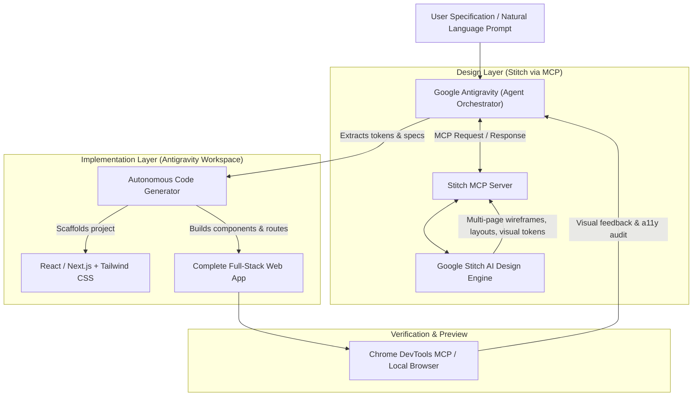
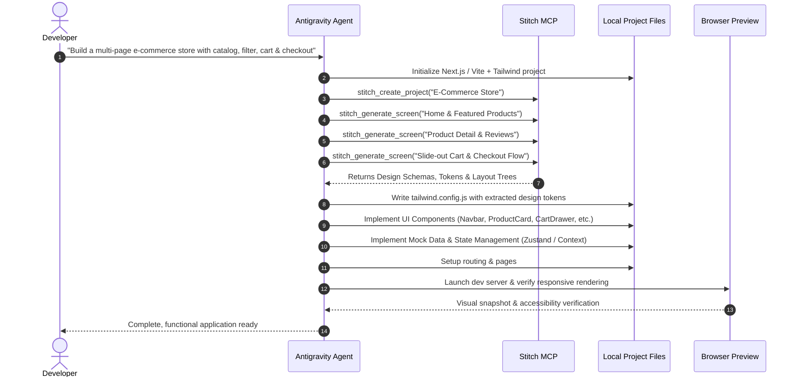

# Complete Guide: Building Full Websites with Google Antigravity & Stitch MCP

> **Based on:** *"Antigravity + Stitch MCP: AI Agents That Build Complete Websites"*  
> **Target Audience:** Developers, AI engineers, product designers, and technical founders.  
> **Core Stack:** Google Antigravity (Agentic IDE), Google Stitch (AI UI/UX Engine), Model Context Protocol (MCP), React / Next.js, Tailwind CSS.

---

## Table of Contents
1. [Executive Summary](#executive-summary)
2. [System Architecture & Core Concepts](#system-architecture--core-concepts)
   - [Google Antigravity](#1-google-antigravity)
   - [Google Stitch](#2-google-stitch)
   - [Model Context Protocol (MCP) Bridge](#3-model-context-protocol-mcp-bridge)
   - [Stitch Skills (`stitch-skills`)](#4-stitch-skills-stitch-skills)
3. [Prerequisites & Environment Setup](#prerequisites--environment-setup)
4. [Step-by-Step Installation & MCP Configuration](#step-by-step-installation--mcp-configuration)
5. [The End-to-End Development Workflow](#the-end-to-end-development-workflow)
   - [Phase 1: Project Scoping & Information Architecture](#phase-1-project-scoping--information-architecture)
   - [Phase 2: UI/UX Generation via Stitch MCP](#phase-2-uiux-generation-via-stitch-mcp)
   - [Phase 3: Design-DNA Extraction (Tokens & Assets)](#phase-3-design-dna-extraction-tokens--assets)
   - [Phase 4: Autonomous Code Generation & Component Assembly](#phase-4-autonomous-code-generation--component-assembly)
   - [Phase 5: State, Interactivity & Mock Backend](#phase-5-state-interactivity--mock-backend)
   - [Phase 6: Quality Assurance, a11y & Responsiveness](#phase-6-quality-assurance-a11y--responsiveness)
6. [Detailed Case Studies from the Tutorial](#detailed-case-studies-from-the-tutorial)
   - [Case Study 1: Modern E-Commerce Platform](#case-study-1-modern-e-commerce-platform)
   - [Case Study 2: Interactive Fitness & Wellness Dashboard](#case-study-2-interactive-fitness--wellness-dashboard)
7. [Prompt Engineering & Agent Collaboration Patterns](#prompt-engineering--agent-collaboration-patterns)
8. [Troubleshooting & Best Practices](#troubleshooting--best-practices)

---

## Executive Summary

Traditional web development suffers from high friction during the **design-to-code handoff**. Designers create wireframes and high-fidelity mockups in tools like Figma; developers manually reconstruct these visuals in code, frequently encountering discrepancies in spacing, typography, responsive behavior, and design tokens.

The integration of **Google Antigravity** with **Google Stitch** via the **Model Context Protocol (MCP)** eliminates this friction. By linking an autonomous coding agent directly to an AI design engine:
1. **Design and code become synchronized**: Antigravity agents can invoke Stitch to generate multi-page application flows, extract design tokens, and verify visual layouts programmatically.
2. **Context-aware generation**: The coding agent formulates Stitch prompts grounded in the existing project structure, dependencies, and business logic.
3. **End-to-end autonomy**: A user can provide a natural-language description and receive a fully functional, multi-page, responsive web application with production-ready code.



---

## System Architecture & Core Concepts

### 1. Google Antigravity
Google Antigravity is an agent-driven development environment and IDE. Unlike traditional code-completion assistants that suggest inline snippets, Antigravity functions as an autonomous pair programmer capable of:
* Decomposing complex goals into sequential execution steps.
* Executing terminal commands, installing packages, and managing background daemons.
* Reading, creating, editing, and refactoring project files.
* Leveraging MCP servers to communicate with external APIs, cloud services, and design tools.

### 2. Google Stitch
Google Stitch is an AI-powered design tool specialized in generating full UI/UX layouts, component hierarchies, design tokens, and user flows. Stitch does not merely generate static images; it structures interfaces with semantic layout metadata, color palettes, typography scales, and responsive guidelines.

### 3. Model Context Protocol (MCP) Bridge
Developed as an open protocol, MCP allows AI agents to securely connect to external tools, APIs, and data sources.
* **Stitch MCP Server**: Exposes endpoints and tools such as `generate_layout`, `get_design_tokens`, `list_screens`, and `export_component_spec`.
* **Antigravity MCP Client**: Discovers available Stitch tools, handles authentication, and allows Antigravity agents to invoke Stitch functions as part of their standard reasoning loop.

### 4. Stitch Skills (`stitch-skills`)
Skills are modular packages containing instructional markdown, schema definitions, and workflow scripts. The `stitch-skills` suite equips Antigravity with specialized operational procedures, including:
* How to prompt Stitch effectively for different design aesthetics (minimalist, modern SaaS, brutalist, playful).
* How to interpret Stitch's output formats and translate them into Tailwind CSS classes, CSS variables, and JSX structures.
* Best practices for maintaining consistent color schemes and component styling across multi-page workflows.

---

## Prerequisites & Environment Setup

Ensure the following tools and accounts are prepared:

| Requirement | Version / Specification | Purpose |
| :--- | :--- | :--- |
| **Node.js** | `>= 18.x LTS` (v20+ recommended) | Runtime for frontend tooling (Vite, Next.js, npm/pnpm). |
| **Git** | Latest stable | Source control and repository management. |
| **Google Antigravity** | Latest preview / release | The primary agent workspace and IDE. |
| **Stitch Access / API Key** | Active Google Labs / Cloud account | Authentication for the Stitch design service. |
| **MCP Runtime** | `npx` or local Python runtime | Execution environment for the Stitch MCP server daemon. |

---

## Step-by-Step Installation & MCP Configuration

### 1. Locating the Antigravity MCP Configuration
In Antigravity, MCP servers are registered either through the **Settings > MCP Servers** UI or directly in the configuration file:
* **Windows**: `%APPDATA%\Antigravity\mcp_config.json` (or `~/.gemini/antigravity/mcp_config.json`)
* **macOS / Linux**: `~/.config/antigravity/mcp_config.json`

### 2. Registering the Stitch MCP Server
Add the Stitch MCP configuration block to your `mcp_config.json`:

```json
{
  "mcpServers": {
    "stitch": {
      "command": "npx",
      "args": [
        "-y",
        "@google-labs/stitch-mcp"
      ],
      "env": {
        "STITCH_API_KEY": "YOUR_STITCH_API_KEY_HERE",
        "STITCH_ENVIRONMENT": "production"
      }
    }
  }
}
```

> [!NOTE]
> If using an organization-hosted or local Python variant of the server:
> ```json
> {
>   "mcpServers": {
>     "stitch": {
>       "command": "python",
>       "args": ["-m", "stitch_mcp_server"],
>       "env": {
>         "STITCH_API_KEY": "YOUR_STITCH_API_KEY_HERE"
>       }
>     }
>   }
> }
> ```

### 3. Installing `stitch-skills`
Skills can be installed globally or per-workspace. In your Antigravity project root:
```bash
# Clone or copy stitch-skills into the .antigravity/skills directory
mkdir -p .antigravity/skills
git clone https://github.com/google-labs-code/stitch-skills.git .antigravity/skills/stitch-skills
```
Alternatively, if installed as an Antigravity plugin:
```
/plugin install google-labs/stitch-mcp-plugin
```

### 4. Verifying MCP Connectivity
Restart the Antigravity agent or run the tool discovery command. Confirm that the following MCP tools are active:
* `stitch_create_project(name, description)`
* `stitch_generate_screen(project_id, prompt, device_type)`
* `stitch_get_tokens(project_id)`
* `stitch_export_layout(screen_id, format)`

---

## The End-to-End Development Workflow



### Phase 1: Project Scoping & Information Architecture
Before invoking design or coding tools, Antigravity analyzes the user request and outlines:
* Target routes (e.g., `/`, `/products`, `/product/:id`, `/checkout`).
* Required interactive states (filters, modals, drawers, form validation).
* Architectural choices (React + Vite vs. Next.js App Router, Tailwind CSS, Lucide icons, Zustand/Context for state).

### Phase 2: UI/UX Generation via Stitch MCP
Antigravity delegates the visual and spatial design to Stitch:
* Invokes `stitch_generate_screen` with precise context regarding typography, contrast standards, target audience, and layout hierarchy.
* Generates desktop, tablet, and mobile variations for each core view.

### Phase 3: Design-DNA Extraction (Tokens & Assets)
Once the screens are finalized in Stitch, the agent extracts the foundational design tokens:
* **Colors**: Primary brand color, secondary accent, neutral backgrounds, border strokes, and semantic states (error, success, warning).
* **Typography**: Font family pairings (e.g., Inter, Plus Jakarta Sans, Outfit), font weights, and fluid scale rules.
* **Spacing & Radii**: Consistent padding scales (`p-4`, `p-6`, `p-8`) and border-radius conventions (`rounded-xl`, `rounded-2xl`).

These tokens are immediately written to `tailwind.config.js` or `globals.css`:
```javascript
// tailwind.config.js generated from Stitch tokens
export default {
  content: ["./index.html", "./src/**/*.{js,ts,jsx,tsx}"],
  theme: {
    extend: {
      colors: {
        brand: {
          50: '#f0f7ff',
          500: '#0066ff',
          600: '#0052cc',
          900: '#002966',
        },
        surface: {
          light: '#f8fafc',
          card: '#ffffff',
          dark: '#0f172a',
        }
      },
      borderRadius: {
        'card': '1rem',
        'button': '0.75rem',
      }
    },
  },
  plugins: [],
};
```

### Phase 4: Autonomous Code Generation & Component Assembly
Antigravity iterates through the project hierarchy, creating modular, reusable components based on Stitch's layout trees:
* Breaks monolithic views into atomic components (`Header`, `HeroSection`, `ProductGrid`, `FilterSidebar`, `Footer`).
* Uses standard accessible HTML semantics (`<main>`, `<nav>`, `<aside>`, `<section>`, `<article>`).
* Applies Tailwind utility classes directly mapped from Stitch specifications.

### Phase 5: State, Interactivity & Mock Backend
Unlike static mockups, the resulting code is fully interactive:
* Implements client state for cart management, filtering, and theme toggling.
* Provides structured mock data fixtures (`src/data/products.ts`) with realistic imagery (Unsplash URLs), descriptions, ratings, and prices.
* Integrates form validation (e.g., Zod + React Hook Form) for input fields like search and checkout forms.

### Phase 6: Quality Assurance, a11y & Responsiveness
The agent executes the development server (`npm run dev`), tests builds (`npm run build`), and runs verification:
* Inspects responsive breakpoints (`sm:`, `md:`, `lg:`, `xl:`).
* Ensures high-contrast accessibility (WCAG AA compliance).
* Validates that there are zero TypeScript compiler errors and zero broken imports.

---

## Detailed Case Studies from the Tutorial

### Case Study 1: Modern E-Commerce Platform

The video highlights building an e-commerce storefront for an athletic footwear brand from a single prompt:

1. **Stitch Generation Request**:
   * Prompts Stitch for an athletic lifestyle brand with a high-contrast dark/neon accent theme.
   * Creates a sticky glassmorphic navigation header, full-width hero with motion cue, filterable catalog grid, interactive product card with hover animations, and a slide-over checkout drawer.
2. **Component Breakdown**:
   * `Navbar.tsx`: Search bar, category dropdown, dynamic cart badge counter.
   * `HeroBanner.tsx`: High-impact headline, CTA button, promotional badges.
   * `FilterSidebar.tsx`: Multi-facet filtering by category, price range, and size tags.
   * `ProductCard.tsx`: Image carousel on hover, color swatches, quick "Add to Cart" button.
   * `CartDrawer.tsx`: Slide-in drawer with item quantity adjustments, subtotal calculation, free-shipping progress meter, and checkout button.
3. **Outcome**:
   * Generated in under 4 minutes.
   * Clean React + TypeScript code with full local state handling and zero external UI library bloat.

---

### Case Study 2: Interactive Fitness & Wellness Dashboard

The second demonstration showcases an analytical dashboard with rich data visualization:

1. **Stitch Generation Request**:
   * Modern SaaS dashboard with clean card architecture, dark mode by default, and vibrant metrics accents.
   * Screens include: Activity Summary, Heart Rate Trends, Calorie Burn Analytics, and Workout Routine Schedule.
2. **Component Breakdown**:
   * `SidebarNav.tsx`: Collapsible navigation with active route highlights.
   * `MetricCard.tsx`: Metric summary cards with percentage indicators (+12.4% vs last week) and sparkline charts.
   * `ActivityChart.tsx`: Responsive chart component (using Recharts or SVG paths) with interactive tooltips.
   * `WorkoutTable.tsx`: Tabular overview of completed sessions with badge statuses (Completed, Scheduled, In Progress).
3. **Outcome**:
   * Fully responsive across mobile, tablet, and widescreen displays.
   * Integrated mock activity datasets providing realistic real-time filtering (Today, 7 Days, 30 Days).

---

## Prompt Engineering & Agent Collaboration Patterns

To obtain optimal results when directing Antigravity and Stitch MCP, employ the **Context-Constraint-Goal (CCG)** prompting structure:

### Recommended Antigravity Prompt Template:
```markdown
You are acting as the lead full-stack engineer and UI designer. 
Using the Stitch MCP server, design and implement a [Product Type, e.g., SaaS Project Management Tool].

### Visual Requirements & Aesthetics:
- Style: [e.g., Clean modern minimalist, Apple/Stripe-inspired, subtle borders, high contrast]
- Color Palette: [e.g., Deep slate #0f172a, crisp white, indigo #6366f1 accent]
- Typography: Inter or Plus Jakarta Sans

### Target Pages & User Flows:
1. Landing / Overview page with key feature highlights and pricing table.
2. Application Dashboard with navigation sidebar, data metrics, and table view.
3. Settings modal or slide-over drawer with form validation.

### Technical Implementation:
- Framework: Vite + React + TypeScript + Tailwind CSS
- Icons: lucide-react
- State Management: React useState / Context API with realistic mock data
- Ensure all components are responsive (mobile-first) and accessible.
```

---

## Troubleshooting & Best Practices

| Issue / Symptom | Root Cause | Solution |
| :--- | :--- | :--- |
| **`stitch tool not found`** | MCP server is not registered or failed to boot in Antigravity. | Check `mcp_config.json`, verify `STITCH_API_KEY`, and restart Antigravity. Run `agy mcp list` or inspect the MCP status indicator. |
| **Styling Discrepancies** | Missing custom tokens in `tailwind.config.js`. | Ensure the agent executes `stitch_get_tokens` before scaffolding components and appends extended colors and font families into the Tailwind config. |
| **Missing Image Placeholders** | Hardcoded broken asset links in generated HTML. | Instruct the agent to use reliable dynamic placeholder services such as Unsplash CDN (`https://images.unsplash.com/...`) with descriptive semantic tags. |
| **Large Bundle / Sluggish Dev Server** | Over-importing heavy third-party UI component libraries. | Prefer lightweight Tailwind utility components and tree-shakable icons (`lucide-react`) rather than importing monolithic component frameworks. |
| **Screen Overflow on Mobile** | Hardcoded fixed pixel widths (`w-[600px]`) in layouts. | Enforce responsive constraints: use `w-full max-w-xl`, flexible grid templates (`grid-cols-1 md:grid-cols-3`), and test in mobile viewport. |

---

## Summary

The synergy of **Google Antigravity** and **Stitch MCP** represents the modern vanguard of AI-assisted software development:
* **Speed**: Complete, multi-page, production-ready web apps created in minutes.
* **Consistency**: Design tokens and UI architecture are programmatically preserved between concept and code.
* **Maintainability**: Output is standard, human-readable TypeScript and Tailwind code that development teams can immediately build upon, refactor, and deploy.
